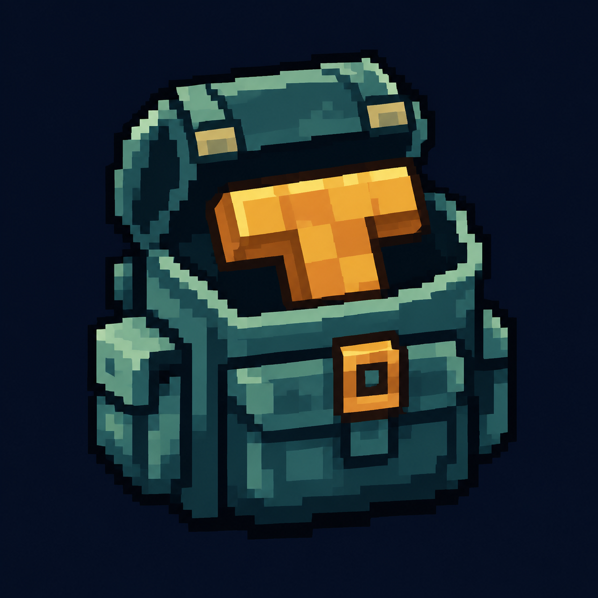

<div align="center">



# ExtractionCombatCore

**A Minecraft mod design for extraction-style looting, where data packs define what fits in a bag and what it takes to open a container.**

English | [简体中文](README.zh_CN.md)

</div>

**Status: design stage.** The [gameplay and data pack specification (in Chinese)](docs/搜刮玩法设计.md) describes the proposed mechanics. There is no playable build yet.

## A minute at the service cabinet

A powered cabinet has two ways in. Use a service key and hold for one second, or stay at the cabinet with a decoder. The decoder finishes on its own; timing a few inputs shortens the wait. Other containers can ask for a password, play a Morse message, show a Morse pattern, or use a scrolling character lock.

Once the door opens, a magnifier sweeps across an opaque grey cover. A stack of iron nuggets appears first. You can take it and leave, or stay to uncover a hook five cells wide. Only revealed items show their quality outline. A data pack can supply its own quality; otherwise the outline follows the stack’s vanilla rarity.

## Will the hook fit?

```json
{
  "item": "minecraft:tripwire_hook",
  "shape": ["  X  ", "XXXXX"],
  "rotatable": true,
  "icons": {
    "grid": "example:item/service_hook_grid",
    "vanilla_slot": "example:item/service_hook_slot"
  }
}
```

A resource pack supplies the two optional textures. In a mod backpack or container, an 80×32 PNG spans the entire five-by-two shape and turns with the hook. Empty cells stay clear. In the vanilla inventory or hotbar, the same hook uses its separate single-slot icon.

The hook spans a five-by-two rectangle but occupies only the six `X` cells. Small items can fill the four gaps. Drag toward one of a slot’s four edges to choose the hook’s orientation. Double-click to transfer a whole stack between the backpack and the open container: existing items only move if the stack will not fit directly. If rearranging cannot make room, both inventories keep their original layouts.

## Defining a data pack

| Directory under `data/<namespace>/extraction/` | What it describes |
|---|---|
| `backpacks/` | The bag’s outer footprint and its separate internal compartments. |
| `containers/` | Storage grids, opening conditions, search timing and loot tables. |
| `items/` | Occupied cells, allowed rotation, stack limits and optional custom quality. |

Servers can enable or disable the vanilla main inventory independently of how many hotbar slots are available (0–9). See the [design examples](docs/搜刮玩法设计.md#数据包目录与示例) for a field pack, a service cabinet and the hook that fits inside them.
