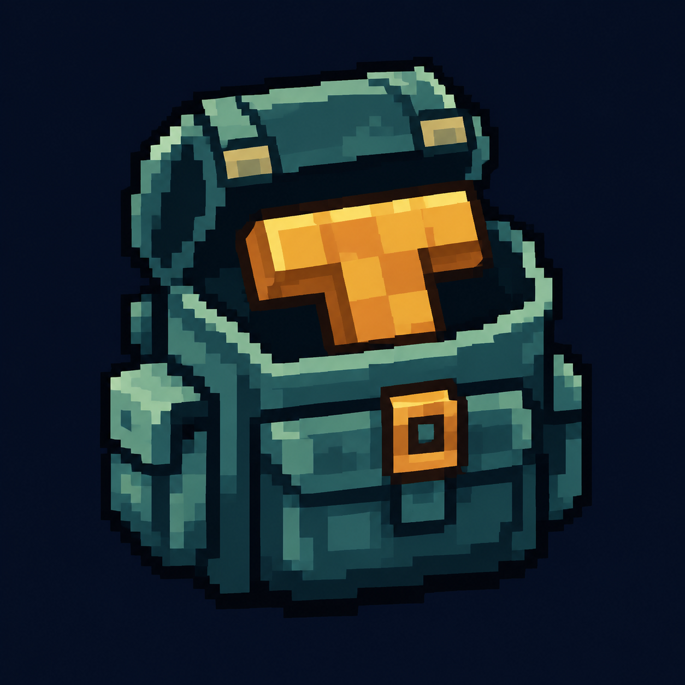
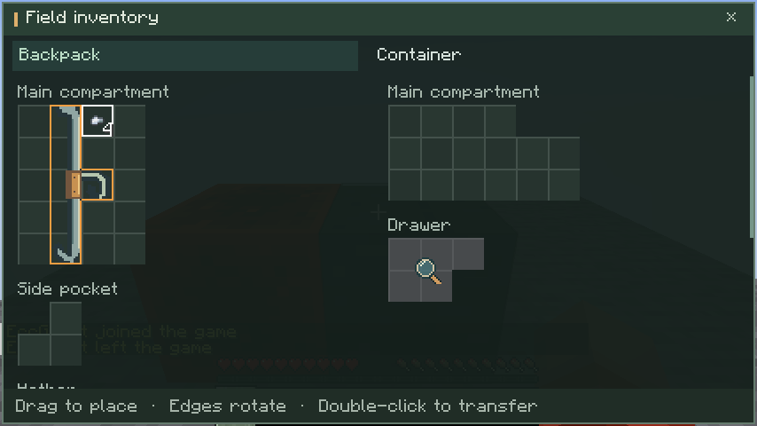

<div align="center">



# ExtractionCombatCore

**面向 Minecraft 搜打撤玩法的搜刮模组，通过数据包定义背包里能装什么、容器要怎么打开。**

[English](README.md) | 简体中文

</div>

本分支面向 Minecraft 1.21.1、NeoForge 和 AnvilLib 2.0.0。运行 `./gradlew build` 构建模组，使用创造栏中的演示套件试玩。[地图作者使用说明](docs/CONFIG.md)

## 在维修柜前搜一分钟

一只通电的维修柜有两种开法。带了维修钥匙，长按一秒就能开门；手里只有译码器，也可以留在柜前等它破译，抓准时机按几次键能缩短等待。地图作者还可以给其他容器设置密码、音频摩斯、图案摩斯或滚动字符锁。

柜门打开后，放大镜开始扫过不透明的灰色遮罩。先露出的是一叠铁粒，你可以拿上就走，也可以多留一会儿，继续翻出一把横跨五格的挂钩。物品揭示后才会显示品质边框：省略 `quality` 会沿用原版稀有度，也可以指定自定义品质，或设为 `"disable"` 隐藏边框与品质提示。



## 挂钩放得下吗？

```json
{
  "item": { "items": "minecraft:tripwire_hook" },
  "shape": ["  X  ", "XXXXX"],
  "rotatable": true,
  "icons": {
    "grid": "example:item/service_hook_grid",
    "vanilla_slot": "example:item/service_hook_slot"
  }
}
```

两张贴图均可选，由资源包提供。放进模组背包或容器时，一张 80×32 像素的 PNG 可以铺满五格宽、两格高的范围，随挂钩转向，空格处保持透明。放进原版物品栏或快捷栏时，同一把挂钩改用独立的单格图标。

挂钩宽五格、高两格，却只占六个 `X`，剩下四个空位仍能塞小件。拖动时靠近目标槽的四条边，就能选择挂钩的朝向。双击可在背包与打开的容器之间转移整叠物品：能直接装下，就不挪动已有物品；只有放不下时才尝试整理。整理后仍装不下，两边都保持原样。

## 编写数据包

| `data/<namespace>/extraction/` 下的目录 | 定义内容 |
|---|---|
| `backpacks/` | 背包作为物品时的外形，以及打开后的独立分区。 |
| `containers/` | 容器网格、开启条件、翻找耗时和战利品表。 |
| `items/` | 物品占格、是否可转向、堆叠上限和可选的自定义品质。 |
| `qualities/` | 可复用的品质名称与边框色。物品按 ID 引用，例如 `"quality": "example:precision"`。 |

服务器可独立配置是否启用原版主背包，以及开放几个快捷栏槽位（0 至 9）。[数据包示例](docs/搜刮玩法设计.md#数据包目录与示例)列出了一只随身背包、一只维修柜和一把能放进两者的挂钩。
